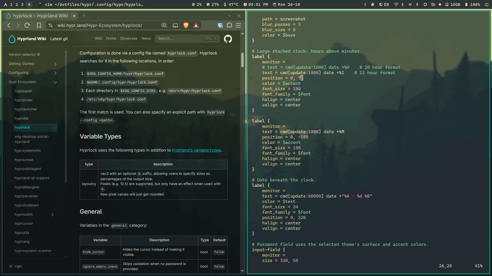
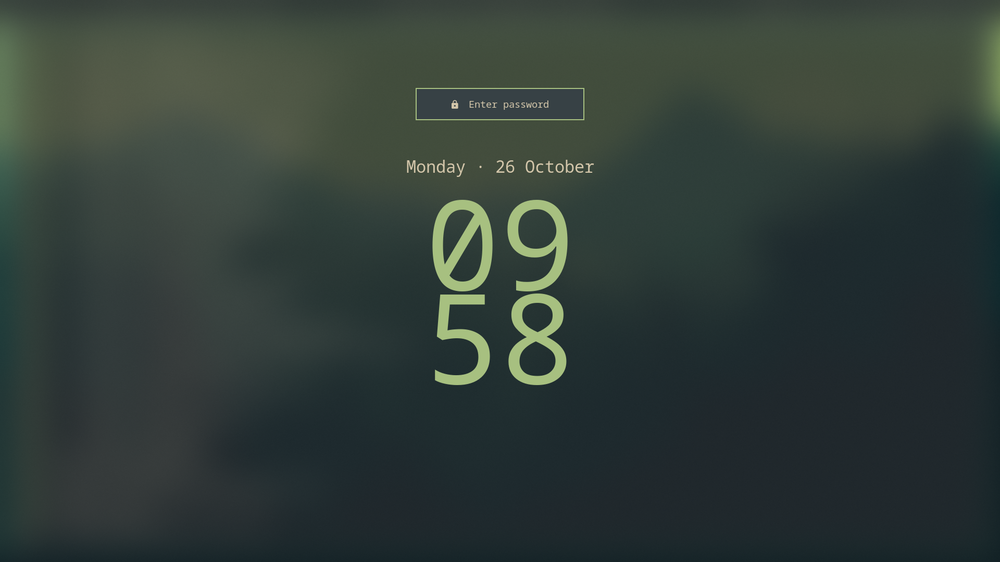
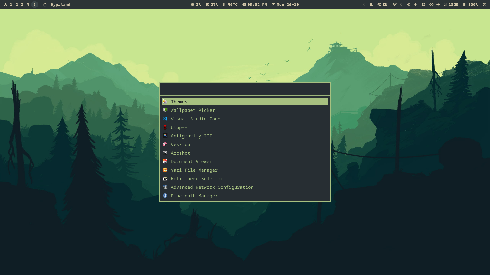
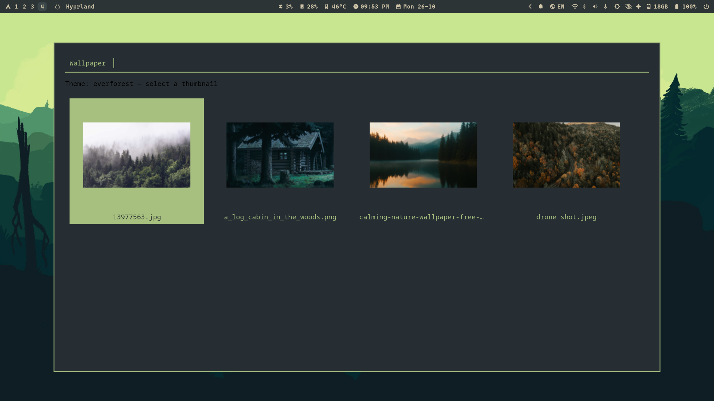
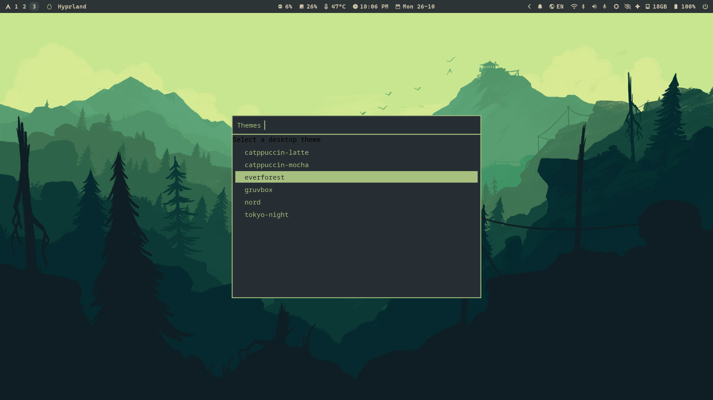

<h1 align="center">jaary's Dotfiles</h1>

<p align="center">
  <b>Arch Linux · Hyprland · Zsh · GNU Stow</b><br>
  A lightweight, theme-aware desktop built around a centralized theme switcher.
</p>

<div align="center">


[](https://github.com/jaary5/dotfiles/commits/main)

</div>

---
<table align="center">
  <tr>
    <td colspan="2" align="center">
      <br>
      <sub><b>General</b></sub>
    </td>
  </tr>
  <tr>
    <td align="center">
      <br>
      <sub><b>Hyprlock</b></sub>
    </td>
    <td align="center">
      <br>
      <sub><b>Rofi</b></sub>
    </td>
  </tr>
  <tr>
    <td align="center">
      <br>
      <sub><b>Wallpaper Picker</b></sub>
    </td>
    <td align="center">
      <br>
      <sub><b>Theme Picker</b></sub>
    </td>
  </tr>
</table>

The desktop is designed around a consistent, square-edged interface. The theme switcher coordinates application colors and wallpapers from one theme library.


## Navigation

- [Overview](#overview)
- [Installation](#installation)
- [Repository structure](#repository-structure)
- [Detailed overview](#detailed-overview)
  - [Hyprland](#hyprland)
  - [Keybindings](#keybindings)
  - [Hyprlock](#hyprlock)
  - [Waybar](#waybar)
  - [Rofi](#rofi)
  - [Dunst](#dunst)
  - [Hyprpaper and wallpapers](#hyprpaper-and-wallpapers)
  - [Theme switcher](#theme-switcher)
  - [Kitty](#kitty)
  - [Zsh and Starship](#zsh-and-starship)
  - [Eza, fzf and zoxide](#shell-utilities)
  - [Yazi](#yazi)
  - [MPV](#mpv)
  - [Arcshot](#arcshot)
  - [Custom scripts](#custom-scripts)
- [Themes](#themes)
- [Dependencies](#dependencies)
- [Managing the dotfiles](#managing-the-dotfiles)
- [Notes](#notes)

## Overview

This repository contains my personal Arch Linux and Hyprland configuration. It is intentionally modular: application configurations are organized as GNU Stow packages, while theme assets and helper scripts live in a shared repository.

The goal is a cohesive, lightweight desktop rather than a prebuilt desktop-environment replacement.

**Core components**

| Component | Role |
|:--|:--|
| Arch Linux | Operating system |
| Hyprland | Wayland compositor and window management |
| Hyprlock | Lock screen |
| Hyprpaper | Wallpaper daemon |
| Waybar | Status bar (floating layout) |
| Rofi | Application launcher, menus and wallpaper picker |
| Dunst | Notifications and Do Not Disturb |
| Kitty | Terminal emulator |
| Zsh | Interactive shell |
| Starship | Shell prompt |
| Eza | Modern directory listing |
| Yazi | Terminal file manager |
| Nautilus | Graphical file manager |
| MPV | Video player |
| Arcshot | Screenshot and screen-recording workflow |
| GNU Stow | Dotfile symlink manager |

## Installation

> [!WARNING]
> These are personal configurations, not a universal installer. They are designed around Arch Linux, Hyprland, Zsh and the paths used in this repository. Review the files and package requirements before applying them to another machine.

> [!IMPORTANT]
> Start with a working Arch Linux + Hyprland session. Back up existing configuration files before stowing anything. If GNU Stow reports a conflict, inspect it instead of forcing or adopting files blindly.

### 1. Install the base tools

```sh
sudo pacman -Syu
sudo pacman -S git stow
```

### 2. Clone the repository

```sh
git clone https://github.com/jaary5/dotfiles.git ~/dotfiles
cd ~/dotfiles
```

### 3. Review and stow the desktop packages

The core packages used by the current Hyprland setup are:

```sh
stow bin dunst hypr kitty rofi waybar
```

Other directories in the repository contain additional or separately maintained configurations. Do not assume that every top-level directory is part of the active desktop setup.

### 4. Initialize the theme system

After the required applications and script dependencies are installed:

```sh
theme-switcher-setup
```

The default theme is `catppuccin-mocha`. You can initialize with another available theme:

```sh
theme-switcher-setup nord
```

### 5. Start or restart Hyprland

Log into the Hyprland session and verify the applications and theme integrations listed below. The setup script applies the theme and creates generated runtime files; GNU Stow alone does not do this.

## Repository structure

```text
dotfiles/
├── bin/.local/
│   ├── bin/                 # theme, wallpaper, audio, disk and utility scripts
│   └── share/applications/  # desktop entries
├── dunst/                   # notification configuration
├── fastfetch/               # system information display
├── hypr/                    # Hyprland, Hyprlock and Hyprpaper
├── kitty/                   # terminal configuration
├── keyd/                    # keyboard remapping configuration and notes
├── mpv/                     # video player configuration
├── rofi/                    # launcher and wallpaper grid
├── starship/                # prompt configuration and palettes
├── themes/                  # shared theme library and wallpapers
├── waybar/                  # floating Waybar configuration
├── yazi/                    # terminal file manager configuration
├── zsh/                     # Zsh configuration
└── docs/                    # setup and troubleshooting notes
```

The repository also contains older or alternative configuration directories (for example, Bash, GNOME and an Omarchy-derived Waybar layout). Their presence does not mean they are used by the current Hyprland session.

## Detailed overview

## Hyprland

Hyprland is the Wayland compositor and the center of the desktop workflow.

**Configuration:** [`hyprland.lua`](./hypr/.config/hypr/hyprland.lua)

The configuration uses Lua and defines the monitor, applications, autostart processes, appearance, window behavior, workspaces, input and keybindings.

Current session autostart includes:

- Dunst, using the generated theme-aware configuration.
- Waybar, using the floating configuration.
- Hyprpolkitagent, for graphical privilege prompts.
- Hyprpaper, using the generated active wallpaper configuration.

The configured applications include Kitty, Nautilus and Rofi. Brave is launched by its keybinding.

### Keybindings

The main modifier is **Super** (Windows key).

<details>
<summary><b>Application launch and desktop controls</b></summary>

| Keys | Action |
|:--|:--|
| <kbd>Super</kbd> | Toggle Rofi using `rofi-toggle` |
| <kbd>Super</kbd> + <kbd>Enter</kbd> | Open Kitty |
| <kbd>Super</kbd> + <kbd>H</kbd> | Open Nautilus |
| <kbd>Super</kbd> + <kbd>R</kbd> | Open Rofi application launcher |
| <kbd>Super</kbd> + <kbd>B</kbd> | Open Brave |
| <kbd>Super</kbd> + <kbd>Shift</kbd> + <kbd>S</kbd> | Launch Arcshot |
| <kbd>Super</kbd> + <kbd>Shift</kbd> + <kbd>L</kbd> | Lock screen with Hyprlock |

</details>

<details>
<summary><b>Window management</b></summary>

| Keys | Action |
|:--|:--|
| <kbd>Super</kbd> + <kbd>Arrow keys</kbd> | Move focus between windows |
| <kbd>Super</kbd> + <kbd>T</kbd> | Toggle floating mode |
| <kbd>Super</kbd> + <kbd>Backspace</kbd> | Close active window |
| <kbd>Alt</kbd> + <kbd>Tab</kbd> | Swap to the next window |
| <kbd>Super</kbd> + <kbd>P</kbd> | Toggle pseudo-tiling |
| <kbd>Super</kbd> + <kbd>J</kbd> | Toggle dwindle split |
| <kbd>Super</kbd> + <kbd>Left/Right mouse</kbd> | Move/resize windows |

</details>

<details>
<summary><b>Workspaces</b></summary>

| Keys | Action |
|:--|:--|
| <kbd>Super</kbd> + <kbd>1–9</kbd> | Switch to workspace 1–9 |
| <kbd>Super</kbd> + <kbd>Shift</kbd> + <kbd>1–9</kbd> | Move active window to workspace 1–9 |
| <kbd>Ctrl</kbd> + <kbd>Super</kbd> + <kbd>Right</kbd> | Next workspace |
| <kbd>Ctrl</kbd> + <kbd>Super</kbd> + <kbd>Left</kbd> | Previous workspace |
| <kbd>Shift</kbd> + <kbd>Super</kbd> + <kbd>Right</kbd> | Move window to next workspace |
| <kbd>Shift</kbd> + <kbd>Super</kbd> + <kbd>Left</kbd> | Move window to previous workspace |
| <kbd>Super</kbd> + <kbd>S</kbd> | Toggle special workspace |
| <kbd>Super</kbd> + <kbd>Mouse wheel</kbd> | Switch workspaces |

</details>

<details>
<summary><b>Media, audio and brightness</b></summary>

| Keys | Action |
|:--|:--|
| <kbd>Volume Up</kbd> / <kbd>Volume Down</kbd> | Change output volume |
| <kbd>Volume Mute</kbd> | Toggle output mute |
| <kbd>Mic Mute</kbd> | Toggle microphone mute |
| <kbd>Brightness Up</kbd> / <kbd>Brightness Down</kbd> | Adjust display brightness |
| <kbd>Play/Pause</kbd> | Toggle media playback |
| <kbd>Previous</kbd> / <kbd>Next</kbd> | Change media track |

</details>

## Hyprlock

Hyprlock provides the lock screen.

**Configuration:** [`hyprlock.conf`](./hypr/.config/hypr/hyprlock.conf)

The design uses a large stacked clock, date and password field. Its colors are loaded from the active theme palette:

`~/.config/theme-switcher/active/hyprlock-colors.conf`

This keeps the lock screen coordinated with the selected desktop theme. The manual lock shortcut is <kbd>Super</kbd> + <kbd>Shift</kbd> + <kbd>L</kbd>.

## Waybar

Waybar provides the desktop status bar.

**Active configuration:** [floating/config.jsonc](./waybar/.config/waybar/floating/config.jsonc) · [floating/style.css](./waybar/.config/waybar/floating/style.css)

The active session explicitly starts the **floating** layout. It uses a compact, square-edged style and theme colors imported from the generated active theme file.

The repository also contains an Omarchy-derived Waybar configuration for reference; it is not the configuration launched by the current Hyprland autostart.

## Rofi

Rofi is used for the application launcher and menu interface.

**Configuration:** [`config.rasi`](./rofi/.config/rofi/config.rasi) · [wallpaper grid](./rofi/.config/rofi/wallpaper-grid.rasi)

Configured modes include application launching, window selection and command execution. The setup includes Vim-style navigation bindings and a dedicated thumbnail grid for choosing wallpapers.

The Super-key toggle is handled by the `rofi-toggle` helper.

## Dunst

Dunst handles desktop notifications and Do Not Disturb.

**Configuration:** [`dunstrc`](./dunst/.config/dunst/dunstrc)

The base configuration uses a compact, square notification style. Theme switching generates an active Dunst configuration and restarts Dunst with that file. The notification helper also provides the theme-aware color integration.

This setup uses **Dunst**, not SwayNC.

## Hyprpaper and wallpapers

Hyprpaper displays the desktop wallpaper.

**Configuration:** [`hyprpaper.conf`](./hypr/.config/hypr/hyprpaper.conf)

Wallpapers are organized inside each theme's `wallpapers/` directory. Theme switching selects a wallpaper from the chosen theme and writes the active Hyprpaper configuration.

Use:

```sh
wallpaper-menu
```

The Rofi picker displays generated thumbnails. Thumbnails are cached under:

```text
~/.cache/wallpaper-menu/<theme>/
```

The selected wallpaper path is stored in:

```text
~/.config/theme-switcher/current-wallpaper
```

## Theme switcher

The theme switcher is the central feature of this repository. It keeps supported applications visually consistent without maintaining separate manual settings for every theme.

**Main scripts:**

- [`theme-switch`](./bin/.local/bin/theme-switch)
- [`theme-switcher-setup`](./bin/.local/bin/theme-switcher-setup)
- [`theme-apply-dunst`](./bin/.local/bin/theme-apply-dunst)
- [`wallpaper-menu`](./bin/.local/bin/wallpaper-menu)

### Available themes

| Theme | Directory |
|:--|:--|
| Catppuccin Mocha | `themes/catppuccin-mocha/` |
| Catppuccin Latte | `themes/catppuccin-latte/` |
| Everforest | `themes/everforest/` |
| Gruvbox | `themes/gruvbox/` |
| Nord | `themes/nord/` |
| Tokyo Night | `themes/tokyo-night/` |

### What changes when switching

| Application | Theme integration |
|:--|:--|
| Kitty | Terminal palette |
| Waybar | Floating bar colors |
| Rofi | Launcher and menu colors |
| Dunst | Notification colors |
| Hyprlock | Lock-screen colors |
| Hyprpaper | Random wallpaper from selected theme |
| Starship | Prompt palette |
| GTK / Nautilus | Dark or light preference |
| Eza | Directory colors where a theme palette is provided |

### Commands

```sh
# List available themes
theme-switch list

# Show the recorded active theme
theme-switch current

# Apply a theme
theme-switch nord

# Open the wallpaper picker
wallpaper-menu
```

`theme-switch current` only reports the saved theme; it does not reapply it.

### Theme architecture

Theme assets are tracked in `~/dotfiles/themes/`. Generated active files and current selections live outside the Stow packages:

```text
~/.config/theme-switcher/
├── active/
│   ├── kitty.conf
│   ├── waybar.css
│   ├── rofi.rasi
│   ├── hyprlock-colors.conf
│   ├── starship.toml
│   └── dunstrc
├── current-theme
└── current-wallpaper
```

The theme directory is the source of truth. Do not make permanent edits to generated files under `active/`; update the corresponding source asset in `themes/<theme>/` instead.

For a deeper explanation, see [Central Theme Management](./docs/central-theme-management.md).

## Kitty

Kitty is the terminal emulator.

**Configuration:** [`kitty.conf`](./kitty/.config/kitty/kitty.conf)

The configuration uses Caskaydia Cove Nerd Font, 11pt text, window padding, hidden window decorations and background opacity. The active theme is included from the generated theme-switcher directory.

## Zsh and Starship

Zsh is the interactive shell, with its configuration split into small files.

**Configuration:** [Zsh directory](./zsh/.config/zsh/)

| File | Purpose |
|:--|:--|
| `.zshrc` | Main shell setup and module loading |
| `aliases.zsh` | Aliases and command replacements |
| `bindings.zsh` | Interactive keybindings |
| `fzf.zsh` | Fzf integration |
| `plugins.zsh` | Plugin initialization |
| `prompt.zsh` | Starship initialization |

The shell setup includes shared history, completion, zoxide, fzf and modular configuration.

**Starship** provides a segmented prompt with OS, username, directory, Git state, language/tool indicators and time. Its palette is updated by the theme switcher.

Useful aliases include:

| Alias | Command |
|:--|:--|
| `ls` | `eza --icons` |
| `ll` | `eza -lh --icons --git` |
| `la` | `eza -lah --icons --git` |
| `tree` | `eza --tree --icons` |
| `cat` | `bat` |
| `grep` | `rg --color=auto` |
| `yz` | `yazi` |
| `kh` | `kitty-hotkeys` |
| `ta` | `toggle-audio` |

> Note: `grep` is aliased to ripgrep (`rg`), so use ripgrep options and syntax in interactive Zsh sessions.

## Shell utilities

- **Eza** — directory listings with icons, Git status and a custom theme file.
- **Fzf** — fuzzy finding and shell integration.
- **Zoxide** — smarter directory jumping.
- **Ripgrep** — fast recursive text search, also used through the `grep` alias.
- **Bat** — syntax-highlighted file viewing.

## Yazi

Yazi is configured as a terminal file manager.

**Configuration:** [`yazi/`](./yazi/.config/yazi/)

The repository includes a Catppuccin Macchiato flavor, a full-border plugin and flavor/plugin dependency metadata.

## MPV

MPV is the configured video player.

**Configuration:** [`mpv.conf`](./mpv/.config/mpv/mpv.conf) · [`input.conf`](./mpv/.config/mpv/input.conf)

The current configuration defines a centered initial window geometry and keeps the window aspect ratio.

## Arcshot

Arcshot is the screenshot and screen-recording workflow launched from Hyprland.

**Launcher:** [`arcshot`](./bin/.local/bin/arcshot)

The launcher points Python to the Arcshot package installed under `~/.local/lib/arcshot`. The active keybinding is <kbd>Super</kbd> + <kbd>Shift</kbd> + <kbd>S</kbd>.

## Custom scripts

Personal scripts are stored in `bin/.local/bin/` and are linked into `~/.local/bin/` through the `bin` Stow package.

| Script | Purpose |
|:--|:--|
| `theme-switch` | Apply and list desktop themes |
| `theme-switcher-setup` | Initialize the theme system |
| `theme-apply-dunst` | Generate the active Dunst theme configuration |
| `theme-menu` | Open the theme selection menu |
| `wallpaper-menu` | Browse and apply theme wallpapers |
| `rofi-toggle` | Toggle Rofi with the Super key |
| `toggle-audio` | Audio toggle helper |
| `arcshot` | Launch Arcshot |
| `kitty-hotkeys` | Display Kitty shortcut help |
| `disk` | Disk usage report and interactive cleanup menu |

The disk utility reports filesystem usage, cache sizes, journal usage and large directories. Cleanup actions require confirmation; review each prompt carefully.

## Themes

Each theme is a directory under `themes/`. The shared assets are consumed by the theme-switcher scripts.

| Asset | Application |
|:--|:--|
| `kitty.conf` | Kitty |
| `waybar.css` | Waybar |
| `rofi.rasi` | Rofi |
| `dunst-colors.conf` | Dunst |
| `hyprlock-colors.conf` | Hyprlock |
| `wallpapers/` | Hyprpaper and wallpaper picker |
| `eza-theme.yml` (where present) | Eza |

### Adding a wallpaper

Place supported image files directly inside the selected theme's `wallpapers/` directory. The wallpaper picker supports PNG, JPG/JPEG, WebP and BMP. It generates and caches thumbnails automatically.

### Adding a theme

1. Copy an existing theme directory.
2. Update the color files for Kitty, Waybar, Rofi, Dunst and Hyprlock.
3. Add a `wallpapers/` directory with at least one supported image.
4. Update optional Eza palette data when applicable.
5. Test it with `theme-switch list` and `theme-switch <theme-name>`.

Keep the asset filenames expected by `theme-switch`; the script validates required files before applying a theme.

## Dependencies

The repository does not currently provide a single authoritative package manifest or automated installer. The table below describes software used by the tracked configuration and scripts; it is not a claim that every item is installed on every machine.

<details>
<summary><b>Desktop and appearance</b></summary>

| Software | Purpose |
|:--|:--|
| Hyprland | Wayland compositor |
| Hyprlock | Lock screen |
| Hyprpaper | Wallpaper daemon |
| Waybar | Status bar |
| Rofi | Launcher and menus |
| Dunst | Notification daemon |
| Kitty | Terminal emulator |
| Nautilus | File manager |
| Starship | Shell prompt |
| Eza | Directory listing |
| Yazi | Terminal file manager |
| MPV | Video player |
| GNU Stow | Dotfile management |

</details>

<details>
<summary><b>Utilities referenced by configuration and scripts</b></summary>

| Utility | Purpose |
|:--|:--|
| `git` | Version control |
| `ripgrep` (`rg`) | Search |
| `fzf` | Fuzzy finder |
| `zoxide` | Directory navigation |
| `bat` | File viewer |
| `ImageMagick` (`magick`) | Wallpaper thumbnail generation |
| `notify-send` | Desktop notifications from scripts |
| `hyprctl` | Hyprland control |
| `wpctl` | PipeWire volume and mute controls |
| `brightnessctl` | Display brightness |
| `playerctl` | Media controls |
| `ncdu` | Disk usage inspection |
| `paccache` | Pacman cache cleanup |
| `eza` | Directory listing |
| `keyd` | Keyboard remapping (when enabled) |

</details>

> Install packages according to your machine and the features you use. Some scripts have optional dependencies; check the script before assuming a package is required.

## Managing the dotfiles

Each Stow package mirrors paths relative to the home directory. For example:

```text
kitty/.config/kitty/kitty.conf
```

is linked to:

```text
~/.config/kitty/kitty.conf
```

### Apply a package

```sh
cd ~/dotfiles
stow kitty
```

### Apply the core desktop packages

```sh
stow bin dunst hypr kitty rofi waybar
```

### Restow or remove a package

```sh
stow -R kitty
stow -D kitty
```

### Verify a symlink

```sh
readlink -f ~/.config/hypr
```

### Update the repository

Edit the symlinked file as usual, then commit the change:

```sh
cd ~/dotfiles
git status --short
git add <path>
git commit -m "Describe the change"
git push
```

## Notes

- This repository is tailored to one Arch Linux + Hyprland environment.
- The active Waybar config is `floating/`; the Omarchy-derived config is retained separately and is not launched by the current session.
- Rofi is the launcher; Walker is not part of the current setup.
- Dunst is the notification daemon; SwayNC is not part of the current setup.
- Theme assets belong in `themes/`; generated active files belong in `~/.config/theme-switcher/`.
- The theme switcher expects the repository at `~/dotfiles`.
- Review package requirements and script behavior before reusing the configuration on another system.

---

<div align="center">
  <sub>Built and maintained as a personal Arch Linux + Hyprland environment.</sub><br>
  <sub><a href="./docs/central-theme-management.md">Theme system documentation</a> · <a href="./docs/arch.md">Arch package management notes</a> · <a href="./docs/audio/audio.md">Audio troubleshooting notes</a></sub>
</div>
